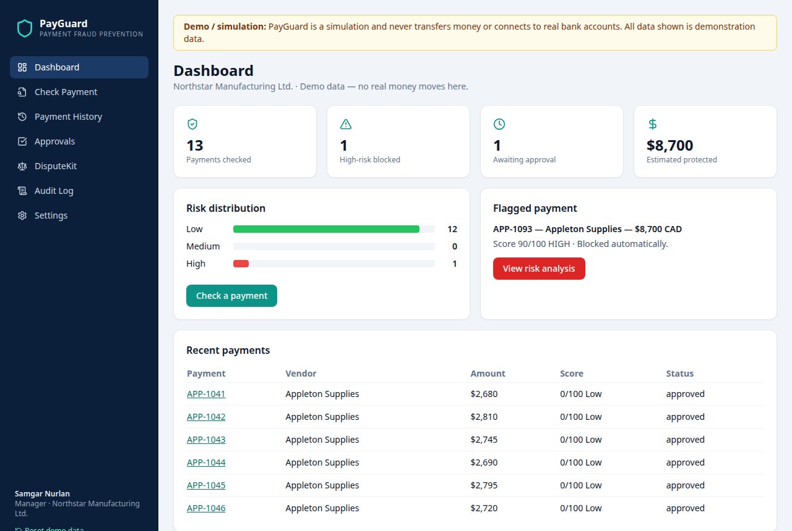
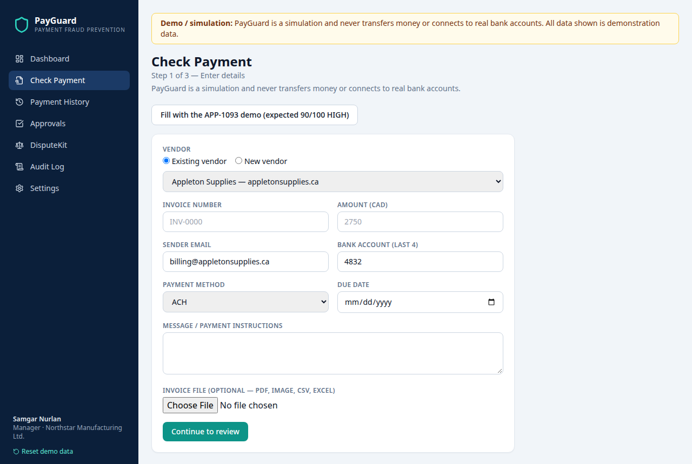
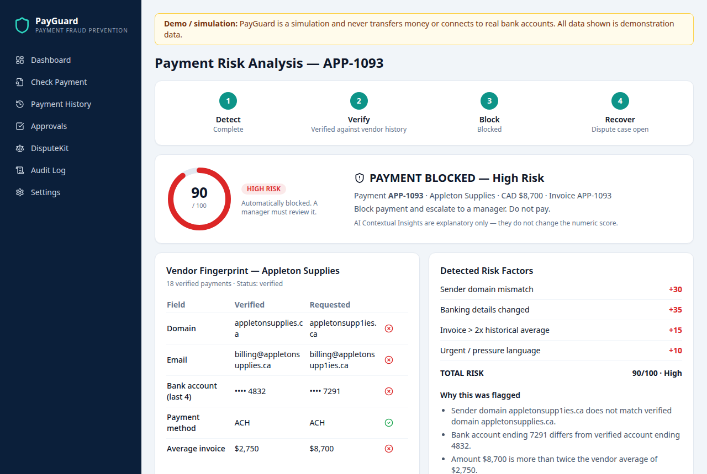
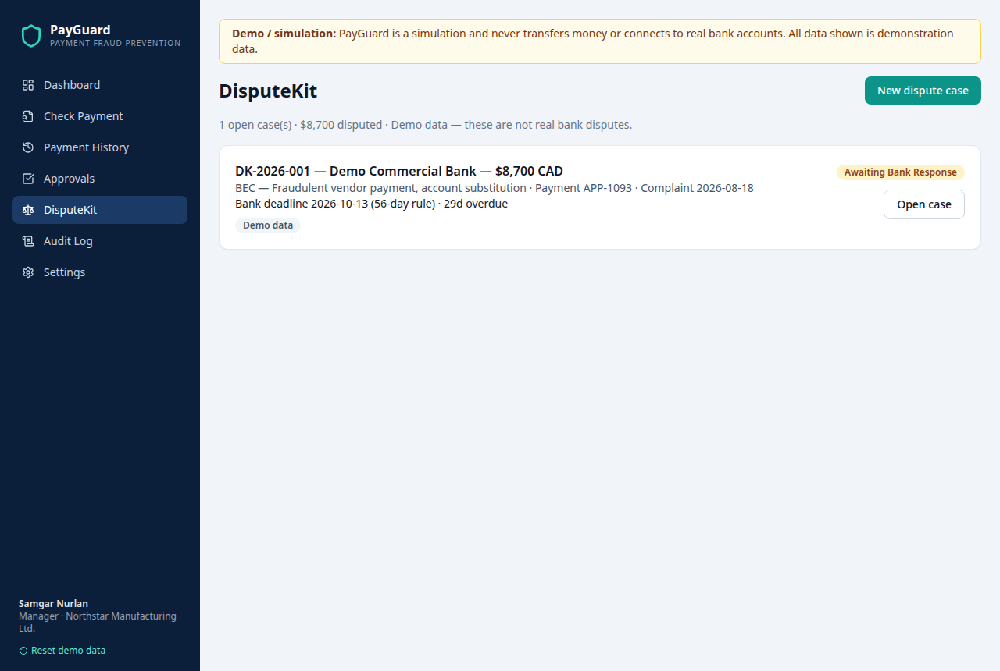

# 🛡️ PayGuard

### Verify the payment, not just the message.

**PayGuard** is an AI-assisted pre-payment fraud prevention platform built for **Ignition Hacks V7 — Fintech Track**.

It helps businesses detect suspicious payment requests **before money leaves the company** by comparing invoices and payment instructions against verified vendor history.

> **Demo / simulation:** PayGuard is a simulation and never transfers money or connects to real bank accounts. All data shown is demonstration data. It is not a real banking or money-transfer service, and its fraud-detection rules are a deterministic demo scorer — not a trained, validated, or production-ready fraud model.

---

## 🚨 The Problem

Business payment fraud often succeeds because fraudulent invoices look nearly identical to legitimate ones.

Common warning signs include:

- Altered sender domains
- Changed banking information
- Unusually large invoice amounts
- Urgent payment requests
- Requests to bypass normal verification procedures

PayGuard moves fraud detection **before the transaction happens**.

---

## ✨ Features

- **Check Payment wizard** — 3 steps (enter details → review & confirm → risk analysis), existing-vs-new vendor toggle, invoice file upload (metadata only in this reconstruction)
- **Deterministic risk scoring** — six transparent rules, capped at 100, with a full breakdown of every point
- **Vendor Fingerprint** — side-by-side verified vs. requested domain, email, bank account, payment method, and average invoice
- **Dashboard** — payments checked, high-risk blocked, awaiting approval, estimated protected amount, risk distribution
- **Payment History** — every checked payment with its score and status
- **Approvals workflow** — high-risk payments are automatically blocked until a manager approves or rejects them
- **DisputeKit** — recovery cases with a 56-day bank response deadline, evidence, timeline, and an 8-section draft Dispute Package
- **Audit Log** — a compliance feed recording every scoring, approval, and dispute action
- **Demo auth** — a local sign-in screen; no real accounts are created

## Screenshots


*Dashboard — 13 payments checked, 1 high-risk blocked, $8,700 estimated protected.*


*Check Payment — 3-step wizard. The "Fill with the APP-1093 demo" button loads the corrected 90/100 scenario.*


*Payment Risk Analysis — APP-1093 scores 90/100 HIGH and is blocked. Vendor Fingerprint shows the lookalike domain and changed bank account.*


*DisputeKit — case DK-2026-001 with the 56-day bank response deadline.*

---

## 💡 How PayGuard Works

1. Upload an invoice or payment request.
2. The app records the payment information (in this reconstruction, file upload stores file metadata only — see Known Limitations).
3. The employee reviews and confirms the extracted values.
4. PayGuard compares the request with verified vendor history.
5. A deterministic risk engine calculates the fraud score.
6. AI provides contextual fraud insights.
7. High-risk payments are automatically blocked.
8. A manager must verify, approve, or reject the request.
9. Blocked payments can be handed off to DisputeKit for recovery tracking.

---

## 📊 Risk Scoring

| Risk Factor | Score |
|---|---:|
| Banking details changed | +35 |
| Sender domain mismatch | +30 |
| New / unverified vendor | +20 |
| Invoice > 2× historical average | +15 |
| Urgent / pressure language | +10 |
| Unusual payment method | +10 |

### Risk Levels

| Score | Risk |
|---:|---|
| 0–39 | 🟢 Low |
| 40–69 | 🟠 Medium |
| 70–100 | 🔴 High |

The scorer is a pure function in `src/lib/scorer.js`, covered by unit tests in `src/lib/scorer.test.mjs` (`npm test`).

### 🧠 AI Contextual Analysis

AI looks for social-engineering signals such as:

- Urgency
- Verification avoidance
- Requests for secrecy
- Suspicious banking-change explanations
- Attempts to bypass normal procedures

> AI contextual insights do **not** independently change the numerical PayGuard risk score. In this reconstruction they are rule-based explanatory text generated from the detected flags — not a live AI model call.

### 🔒 High-Risk Payment Control

High-risk payments are automatically blocked.

Managers can review:

- Risk score
- Triggered risk factors
- Verified vs. requested payment details
- Vendor history
- AI contextual insights
- Original invoice and message

The manager then chooses:

- **Reject Payment**
- **Mark Verified & Approve**

---

## 🎯 Demo Scenario

PayGuard's demo uses **Northstar Manufacturing Ltd.** and its verified supplier **Appleton Supplies**.

### Verified Appleton Profile

| Field | Verified Value |
|---|---|
| Domain | `appletonsupplies.ca` |
| Email | `billing@appletonsupplies.ca` |
| Bank account | `•••• 4832` |
| Payment method | `ACH` |
| Average invoice | ~CAD $2,750 |
| Verified payments | 18 |

A suspicious invoice changes:

- Bank account → `•••• 7291`
- Sender domain → `appletonsupp1ies.ca` (digit "1" in place of "l")
- Amount → CAD $8,700
- Message → urgent payment request

Expected result:

```text
HIGH RISK — 90/100

+35 Banking details changed
+30 Sender domain mismatch
+15 Unusual invoice amount
+10 Urgent language
```

### Why the demo scores 90/100 here, but 20/100 live in Base44

This is a real discrepancy, found during the live Base44 inspection on Nov 10, 2026, and fixed in this reconstruction — not hidden.

Live in Base44, payment APP-1093 scored **20/100 LOW**: its `vendor_id` was null, so no vendor comparison ran and only the +20 new-vendor rule fired. Even linked to Appleton as seeded live, it would only reach 50/100 Medium (banking +35, amount +15), because the seeded sender domain matched the verified domain and there was no urgent language.

In this reconstruction the seed is corrected so the README demo actually triggers: APP-1093 is linked to the Appleton vendor, uses the lookalike domain `appletonsupp1ies.ca`, bank `•••• 7291`, amount CAD $8,700, and urgent language — 35 + 30 + 15 + 10 = **90/100 HIGH**, with the new-vendor rule correctly *not* firing (the vendor is known). The unit test `APP-1093 corrected demo scores 90/100 HIGH` verifies this, and a second test verifies the live behaviour (unknown vendor → 20/100 LOW).

---

## 🧱 Technology Stack

| Layer | Technology |
|---|---|
| Frontend | React 18, React Router 6, Vite 6 |
| Styling | Tailwind CSS 3, shadcn-style components (reimplemented), Lucide icons |
| Data layer | Local state + `localStorage` seed data (`src/lib/store.js`) — no external backend |
| Tests | Node's built-in test runner (`node --test`) |

## 🏗️ Architecture

```text
src/
├── main.jsx                  # React entry point, BrowserRouter
├── App.jsx                   # Routes + demo auth gate
├── index.css                 # Tailwind + shared card/button/input styles
├── lib/
│   ├── scorer.js             # Deterministic risk scorer (pure, tested)
│   ├── scorer.test.mjs       # Unit tests: 90 HIGH, 0 LOW, 45 Medium, 20 unknown-vendor
│   ├── seed.js               # Demo company, vendors, payments, dispute, audit log
│   └── store.js              # Local data layer: analyzePayment, extractInvoice,
│                             #   generateDisputePackage, createRecoveryCase,
│                             #   updateDisputeCaseStatus, 56-day deadline rule
├── components/
│   ├── Layout.jsx            # Dark navy sidebar + simulation banner
│   ├── RiskHero.jsx          # Large score banner on the analysis page
│   ├── RiskScore.jsx         # Circular score gauge
│   ├── VendorFingerprint.jsx # Verified vs. requested vendor comparison
│   ├── AnalysisScanner.jsx   # Detected risk factors + reasons
│   └── LifecycleRibbon.jsx   # Detect / Verify / Block / Recover stages
└── pages/
    ├── Dashboard.jsx         # Stats, risk distribution, flagged payment
    ├── CheckPayment.jsx      # 3-step wizard
    ├── PaymentRiskAnalysis.jsx
    ├── PaymentHistory.jsx
    ├── Approvals.jsx         # Manager approve / reject queue
    ├── DisputeKit.jsx        # Recovery cases
    ├── DisputeCaseDetail.jsx # Evidence, timeline, 8-section package
    ├── NewDisputeCase.jsx
    ├── AuditLog.jsx
    └── Settings.jsx / Login.jsx   # Demo profile + demo sign-in
```

Data flow: Check Payment → `analyzePayment()` in `store.js` → `scorePayment()` in `scorer.js` compares the request against the vendor's verified profile → a `RiskAnalysis` record is created → high-risk payments are blocked and queued in Approvals → a blocked payment can be handed off to DisputeKit via `createRecoveryCase()`. All state persists in `localStorage` under `payguard-demo-v1`; **Reset demo data** in the sidebar restores the seed.

---

## 🚀 Getting Started

### Prerequisites

- Node.js 18+ and npm

### Installation

```bash
git clone https://github.com/snurlan05/payguard-fraud-detection.git
cd payguard-fraud-detection
npm install
```

### Environment configuration

No backend, API key, or real bank connection is required. The app runs entirely locally.

```bash
cp .env.example .env   # optional; only VITE_DEMO_MODE=true is defined
```

### Running the application

```bash
npm run dev      # development server (default http://localhost:5173)
npm run build    # production build (outputs to dist/)
npm run preview  # serve the production build on http://localhost:4173
npm test         # scorer unit tests (node --test)
```

### Demo instructions

1. Open the app and click **Enter demo** (no real account needed).
2. On the Dashboard, note: 13 payments checked, 1 high-risk blocked, $8,700 estimated protected.
3. Open **APP-1093** — it scores **90/100 HIGH** and is blocked. Compare the Vendor Fingerprint: lookalike domain `appletonsupp1ies.ca` vs verified `appletonsupplies.ca`, bank `•••• 7291` vs `•••• 4832`.
4. In **Approvals**, review APP-1093 and choose **Mark Verified & Approve** or **Reject Payment**.
5. Click **Check Payment → Fill with the APP-1093 demo** to submit the same scenario yourself, then watch the wizard produce the same 90/100 analysis. Or submit a clean payment (verified domain, bank `4832`, amount under $5,500, no urgent language) and watch it score 0/100 LOW.
6. Open **DisputeKit → DK-2026-001** to see the recovery case: 5 evidence items, 7 timeline events, the 56-day bank deadline (Oct 13, 2026), and the 8-section draft Dispute Package.
7. Use **Reset demo data** in the sidebar at any time to restore the seed.

### Sample data

All sample data is seeded in `src/lib/seed.js`: Northstar Manufacturing Ltd., three verified vendors (Appleton Supplies, Metro Industrial Parts, Summit Packaging Co.), 12 clean historical payments (0/100, approved), and the corrected APP-1093. The dispute case DK-2026-001 is seeded demo data.

---

## ⚠️ Known Limitations

- **Reconstructed, not recovered.** The original Base44 source code is paywalled on the Base44 Starter plan — only `components.json` was accessible during inspection, and no original code was recovered. This app is a faithful reimplementation from the live app's visible behaviour and the original README. See "Reconstructed from the Base44 prototype" below.
- **No real AI extraction.** File upload records file metadata only. The original `extractInvoice` performed server-side OCR/AI extraction in Base44; that is not implemented here.
- **AI insights are rule-based text**, generated from the detected risk flags — not a live AI model.
- **Local demo data only.** State lives in `localStorage`; there is no multi-user backend, no real authentication, and no persistence beyond the browser. Roles are simplified: the demo user is a Manager.
- **No real bank integration.** Nothing here connects to a bank, moves money, or files a real dispute.
- **Vendor Management and ReviewApproval pages** from the original are admin-gated in Base44 and were not reachable during inspection; vendor data here is the seeded read-only profile set, and approval review is built into the Payment Risk Analysis page.

## 🔮 Future Improvements

- Real invoice OCR/AI extraction behind a clearly labelled provider integration
- A real backend (database + auth) replacing the `localStorage` demo layer
- Vendor Management page for admins to add/edit verified vendor profiles
- Configurable risk rules and thresholds per company
- Email notifications for blocked payments and dispute deadlines
- Exporting the Dispute Package as a PDF

## 🏆 Hackathon Context & Acknowledgments

PayGuard was built for **Ignition Hacks V7 — Fintech Track** as a hackathon prototype, originally developed in **Base44**. Thanks to the Ignition Hacks organisers and the Base44 platform for the original prototype environment. UI conventions follow the shadcn/ui + Tailwind style used in the original; the components here are reimplementations, not copied source.

---

## 🔁 Reconstructed from the Base44 Prototype

| Area | Status |
|---|---|
| Original source code recovered from Base44 | **None.** Source files were paywalled on the Starter plan; only `components.json` (shadcn schema) was accessible. No subscription restriction was bypassed. |
| Code reconstructed from the original implementation | **All application code in this repo.** Rebuilt from the live app's visible pages, workflows, data model (10 entities), risk rules, and the original README, observed Nov 10, 2026 at https://fearless-pay-guard-safe.base44.app. |
| New functionality implemented here | Local `localStorage` data layer replacing the Base44 backend; deterministic scorer as a tested pure function; the corrected APP-1093 seed (see above); demo auth; "Reset demo data". |
| Functionality still dependent on Base44 | **None.** This app runs independently of Base44. What is *not* reproduced is the original server-side invoice OCR/AI extraction and Base44's hosted auth/data — see Known Limitations. |

Live inspection notes: `~/workspace/github-audit/payguard-base44-inspection.md` (in the author's working notes; the Base44 app itself remains at https://fearless-pay-guard-safe.base44.app).
